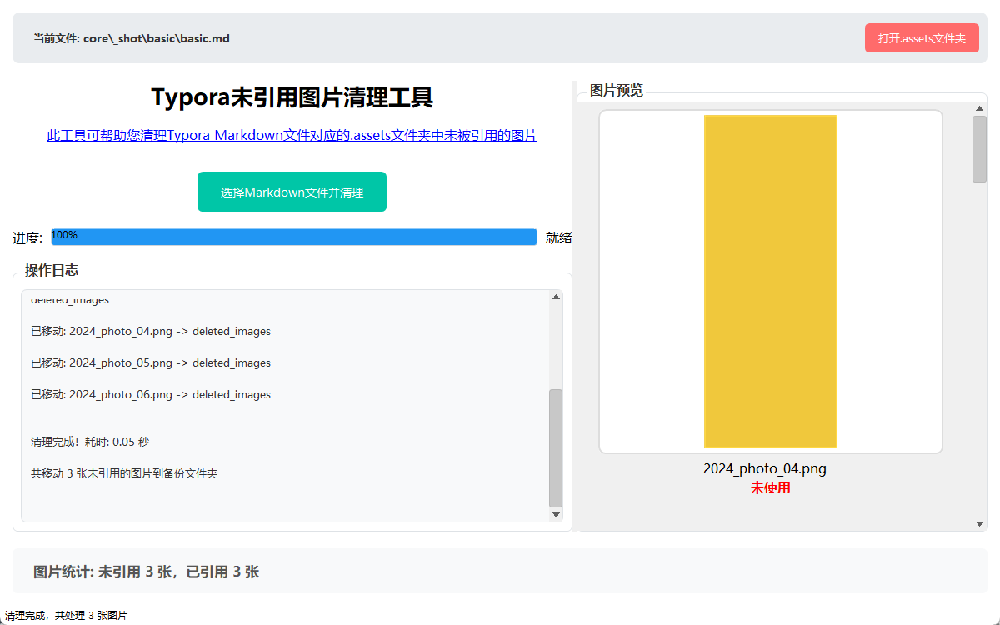

# MD Image Cleaner

> 找出 Markdown 笔记同名 `.assets` 文件夹里**没被引用**的图片，先给你看缩略图，
> 确认之后再移动到 `deleted_images`。
>
> **只移动，不删除。** 移错了把图片拖回去就恢复了。

支持 **Typora / Obsidian / VSCode** —— 只要你用的是「笔记.md + 笔记.assets」这种同名资源夹。

<p align="center">
  <a href="https://github.com/qiapicoco/typora-assets-image-cleaner">GitHub</a> ·
  <a href="https://gitee.com/qiapicoco/typora-assets-image-cleaner">Gitee</a> ·
  <a href="https://github.com/qiapicoco/typora-assets-image-cleaner/releases">下载</a>
</p>

<p align="center">
  
</p>

---

## 这是什么

写 Markdown 时插了图又删掉，图片还留在 `.assets` 文件夹里，越攒越多。
这个小工具把它们揪出来，但**不会替你删**：列出来给你看，你确认了才动。

一个程序，四种形态：

| 形态 | 装在哪 | 体积 | 适合 |
| --- | --- | --- | --- |
| **桌面程序**（C++ 单文件 exe） | 双击就用，可安装 | **300 KB** | 谁都行，功能最全 |
| **Obsidian 插件** | `.obsidian/plugins/md-image-cleaner/` | 20 KB | Obsidian 用户，不切窗口 |
| **VSCode 扩展** | `.vsix` 一键装 | 9 KB | 在编辑器里直接清 |
| **Typora 插件** | 配合 `obgnail/typora_plugin` | 20 KB | Typora 用户，快捷键呼出 |

体积对比：原 PyQt5 版打包后 **28.7 MB** → 现在 **300 KB**，缩小 95 倍。

---

## 桌面程序

### 下载

到 [GitHub Releases](https://github.com/qiapicoco/typora-assets-image-cleaner/releases)
或 [Gitee 发行版](https://gitee.com/qiapicoco/typora-assets-image-cleaner/releases) 下载，两个源内容一致：

- `MDImageCleaner_v2.0.0_setup.exe` —— 安装包（247 KB），自带卸载、桌面快捷方式
- `MDImageCleaner.exe` —— 绿色版单文件（301 KB），拷到哪都能跑

### 怎么用

1. 双击运行
2. 点「选择Markdown文件并清理」选你的 `.md`
3. 右侧看图，底部看统计
4. 完事会告诉你移动了几张

也可以直接把 `.md` 文件拖到 exe 上，或用命令行：

```bash
MDImageCleaner.exe --check 笔记.md        # 只分析，不动文件（安全）
MDImageCleaner.exe --apply 笔记.md        # 分析并移动
MDImageCleaner.exe --check 笔记.md --json # 结果输出成 JSON
MDImageCleaner.exe --open  笔记.md        # 开界面并加载这个文件
```

### 安全性

- 只动你选中的那个 `.md` 对应的 `.assets`，别的目录一概不碰
- 移动不是删除，`deleted_images` 里随时能捞回来
- 不联网、不上传、不写注册表业务数据
- 卸载不会碰你笔记目录里的任何图片

---

## 插件

三个插件共用同一套判定逻辑（`shared/md-cleaner-core.js`），和桌面版逐字节对齐，
已经用 6 组用例跟原 Python 版对拍过。

各插件有自己的安装说明：

- [Obsidian 插件 →](obsidian-plugin/README.md)
- [VSCode 扩展 →](vscode-extension/README.md)
- [Typora 插件 →](typora-plugin/README.md)

插件默认开启**增强模式**：`![[图.png]]`、`` 也算“已引用”，
避免把 wiki 嵌入的图片误判成没用的。桌面版为了跟原版行为一致，保持兼容模式。

---

## 判断规则

对 `笔记.md`：

1. 找同名资源夹 `笔记.md` → `笔记.assets/`
2. 读正文，抽出被引用的图片名
3. 资源夹里存在、但正文没引用的 → **未引用**
4. 移动 `未引用` 到 `笔记.assets/deleted_images/`

认这 8 种扩展名：`.png .jpg .jpeg .bmp .svg .tiff .webp .gif`

**兼容模式**（桌面版默认）只认 `` 和 `[text](path)`，与原版 Python 工具逐字节一致。
**增强模式**（插件默认）额外认 `![[wiki]]` 和 ``。

> ⚠️ 老版本（PyQt5 那个）有个坑：它不认 `![[wiki]]` 和 ``，
> 用 Obsidian 的笔记会被整批误判成未引用、全部移走。插件默认的增强模式就是为了堵这个。
> 桌面版保持兼容模式是为了「行为完全不变」，需要的话用插件清 Obsidian 笔记。

---

## 项目结构

```
core/            黄金用例（原 Python 逻辑产出的基准 JSON）+ 对拍脚本
  gen_cases.py   用原版源码跑出基准
  cases/*.json   6 组基准：日志/进度/统计/移动结果全部逐字段
  check.py       跑桌面版 core_test.exe 与基准比对
desktop/         桌面程序（C++17 + Win32 自绘，无 MFC/Qt/WebView）
  src/core.h     纯函数核心（无 IO、不碰 UI）
  src/paint.h    GDI+ 自绘原语、断行
  src/main.cpp   UI 与消息循环
  src/cli.h      命令行 + JSON 输出
  res/           图标 / manifest / VERSIONINFO
  installer/     NSIS 安装包
shared/          插件共用的 JS 核心（纯函数）
obsidian-plugin/ Obsidian 插件
vscode-extension/VSCode 扩展
typora-plugin/   Typora 插件（obgnail/typora_plugin 自定义插件）
tools/           构建、截图、像素对拍、插件打包
legacy/          原 PyQt5 版本（作为回归基准，别删）
```

---

## 自己构建

### 桌面程序

需要 [zig](https://ziglang.org/)（当 C++ 交叉编译器用，不装 Visual Studio）：

```bash
python desktop/build.py            # → desktop/dist/MDImageCleaner.exe
python desktop/installer/build_installer.py   # → MDImageCleaner_v2.0.0_安装版.exe（需 NSIS 3.x）
```

### 插件

```bash
python tools/build_plugins.py      # → 三个插件产物 + .vsix
```

---

## 验证

这个项目改的是「一个已经在用的工具」，所以每一步都对拍过：

```bash
python core/check.py          # 桌面版核心 vs 原 Python 版：6/6 逐字段一致
node shared/test_core.js      # 插件 JS 核心 vs 同一批基准：7/7
node tools/test_plugins.js    # 插件文件操作（含重名、路径穿越）：8/8
```

界面也有像素级对拍：`docs/ref_original_*.png`（原版）vs `docs/new_*.png`（新版），
空态差异 **0.5%**，剩下的全是字体抗锯齿相位差。

---

## 已知差异（有意为之）

| 项目 | 原版 | 现在 | 为什么 |
| --- | --- | --- | --- |
| 未引用图片的缩略图 | 基本都是灰块（先移文件后读图，竞态） | 正常显示 | 修掉了原版的 bug |
| `![[wiki]]` / `` 引用 | 认不出，会被误移 | 插件认；桌面版保持兼容 | 避免数据意外 |
| 体积 | 28.7 MB | 300 KB | 去掉 PyQt5 运行时 |
| 语言 | Python + PyQt5 | C++17 + Win32 | 体积与启动速度 |

---

## License

MIT
